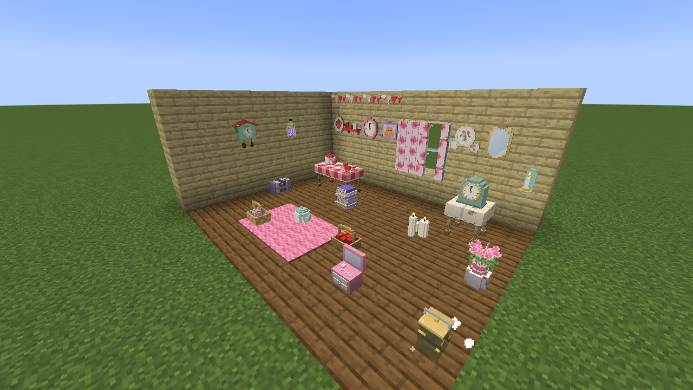
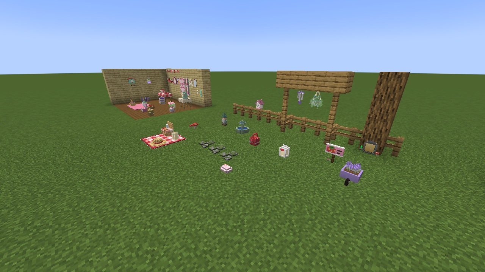
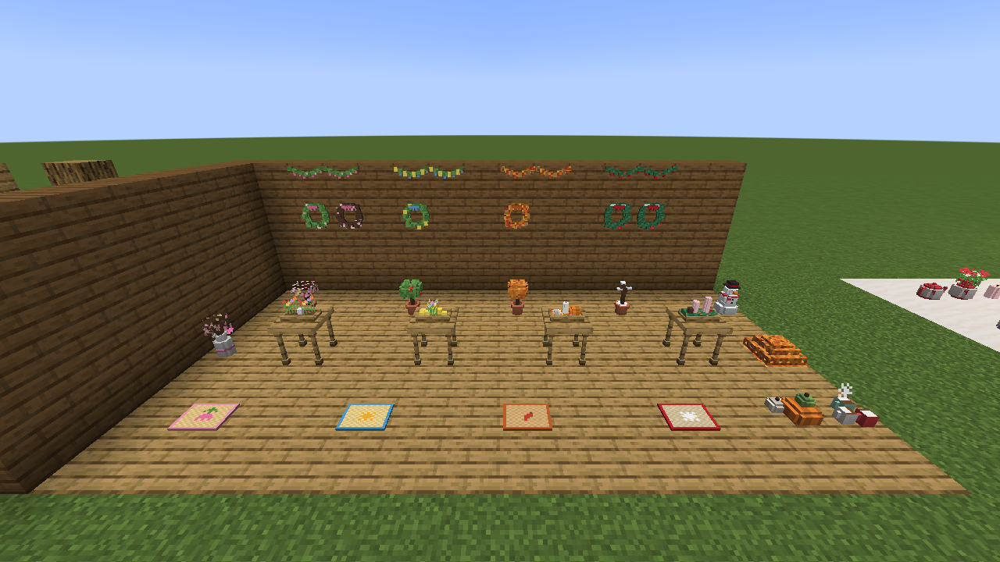
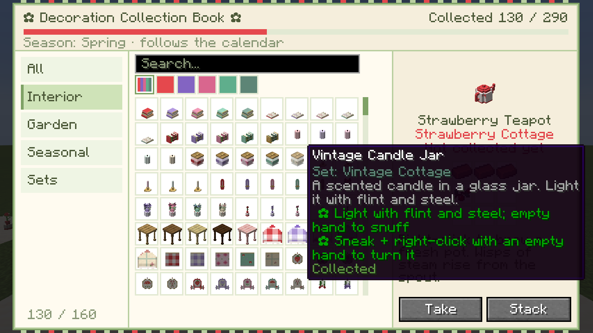

# Cottagecore Living — The Little Details 🌼

*A Sugarplum Studios mod for Minecraft Java 1.20.1 (Forge 47.x)*

The tiny details that make a house feel lived-in. **285 decorations** in 84 kinds,
plus 5 tablecloths and the **Decoration Collection Book**: books and candles, vases,
clocks, curtains, mirrors and picture frames, birdhouses, wind chimes, fountains,
fairy doors, and seasonal decor that changes with the time of year. Most of the
collection comes in **five themed sets**: Strawberry Cottage, Lavender Home,
Pink Garden, Fairycore and Vintage Cottage.

Every decoration is a placeable block with its own 3D model, faces the player when
placed, can be turned afterwards, and hangs on walls or from ceilings where that
makes sense. Many of them do something when you right-click them.

| | |
|---|---|
|  |  |
|  |  |

Every decoration at a glance: [interior](docs/catalog_interior.png), [garden](docs/catalog_garden.png), [seasonal](docs/catalog_seasonal.png).

---

## Building

| Command | What it does |
|---|---|
| `python tools/generate_assets.py` | Regenerates every texture, model, blockstate, item model, loot table, recipe, tag, the language file **and** `catalog/DecorCatalog.java`, then checks every reference and looks for recipes that would shadow each other. |
| `./gradlew build` | Builds the mod jar: `build/libs/cottagecoreliving-forge-1.20.1-1.0.0.jar`. |
| `./gradlew runClient` | Starts a development client with the mod. |
| `./gradlew runGameTestServer` | Runs the 13 automated in-game tests and exits (non-zero on failure). |
| `./gradlew runClient -Pshowcase` | Builds a decorated showcase world, screenshots each scene and the collection book into `run/screenshots/`, then quits. Development only; it is left out of the jar. |
| `python tools/preview_models.py out.png <model>...` | Renders models to an isometric preview sheet without starting Minecraft. |
| `python tools/make_logo.py [--sheets]` | Rebuilds the mod-list logo from real renders; `--sheets` also writes `docs/catalog_*.png`. |

Requires Java 17 (Minecraft 1.20.1's runtime) and Python 3.8+ for the asset tools (no extra packages).
For previews of models that borrow vanilla textures, set `CL_VANILLA` to the
`assets/minecraft` folder of an extracted 1.20.1 client jar.

**Single source of truth:** the decorations are defined once, in `tools/clgen/`
(geometry, variants, behaviour, recipe). The generator writes all resources and the
Java catalog the mod registers its blocks from, so adding a decoration never means
editing Java and JSON by hand in several places.

---

## Controls at a glance

| Action | What happens |
|---|---|
| Place | Floor decorations face you. Click the side of a block to hang wall decorations; click the underside of a block to hang lanterns, chimes, planters and birdhouses. |
| Sneak + right-click (empty hand) | Turns a floor or hanging decoration a quarter turn. |
| Place the same item on it | Adds to a stack: books, pillar candles, jam jars, pumpkins, hot cocoa mugs, stone cairns, leaf piles (up to 3). |
| Flint and steel / fire charge | Lights candles. An empty hand snuffs them. |
| Right-click (empty hand) | The decoration's own interaction, listed in its tooltip (see below). |

Decorations need something to stand on, hang from or hang against; if that block
is broken, the decoration drops. They can be waterlogged. Floor decorations placed on
something thin, like a picnic blanket or a carpet, settle down onto it instead of
floating a block up, so a picnic basket really sits on its blanket.

---

## The collection

Items marked **×5** come in all five sets (Strawberry, Lavender, Pink Garden, Fairy, Vintage).

### Interior (155)
| Group | Decorations | Notes |
|---|---|---|
| Books | Stacked Books ×5, Open Book ×5, Book Row ×5 | Stack books three high. Right-click an open book to read a line. |
| Candles | Pillar Candles ×5, Candle Jar ×5, Candlestick ×5, Candle Sconce ×5 | Light 4 per pillar candle (up to 12), jars 6, candlesticks 7, sconces 8. Real flame particles. |
| Vases | Flower Vase ×5, Bud Vase ×5 | Each set has its own bouquet: roses & daisies, lavender, peonies, bluebells, dusty roses. |
| Tables | Cottage Table in oak, spruce, birch, dark oak, cherry | Full height, so decorations stand right on top. Tables side by side join. Dress them with a **tablecloth** (×5, an item); shears take it off. |
| Curtains | Curtains ×5 | Hang against a window; right-click to tie them back. Stack them for tall windows: only the top shows the rod, and the whole column opens together. |
| Wall decor | Embroidery Hoop ×5, Wall Plates ×5, Dried Flower Bundle ×5, Bunting ×5, Little Wall Shelf ×5 | |
| Clocks | Wall Clock ×5, Mantel Clock ×5, Cuckoo Clock ×5 | The hour hand follows the time of day. Right-click to read the time. Cuckoo clocks call out every hour. |
| Boxes | Trinket Box ×5, Jewelry Box ×5 | 9 slots each; the lid opens while in use. The jewelry box chimes. Hoppers and comparators work. |
| Mirrors | Oval Wall Mirror ×5, Vanity Mirror ×5 | Right-click for a compliment. |
| Picture frames | Picture Frame ×5 (wall), Standing Photo Frame ×5 | Eight little paintings each; right-click to swap. |
| Baskets | Wicker Basket and baskets of apples, bread, yarn, eggs, wildflowers, mushrooms, linens, strawberries, lavender | Craft an empty basket, then fill it. |
| Kitchen & pantry | Teapot ×5, Teacups ×5, Potted Basil/Rosemary/Mint/Thyme/Sage, Jars of Wildflowers/Buttons/Honey/Ribbons, Firefly Jar | Teapots and teacups steam; the firefly jar glows (light 9). |

### Garden (89)
| Group | Decorations | Notes |
|---|---|---|
| Birdhouses | Birdhouse ×5 | On a post or hung from a branch. Birds chirp now and then. |
| Wind chimes | Wind Chime ×5 | Hang from a ceiling or a wall bracket. They ring in the breeze, more often in the rain. |
| Garden signs | Garden Sign ×5 | Eight painted pictures (welcome heart, herbs, strawberries, tulips, bees, carrots, toadstools, sunshine). |
| Planters | Flower Basket ×5, Hanging Planter ×5, Window Box ×5, Flower Wheelbarrow ×5 | |
| Garden tools | Watering Can ×5, Garden Tool Rack, Bucket of Garden Tools, Garden Gloves ×5, Seed Packet Crate | The watering can waters the 3×3 patch in front of it, giving crops a little growth. |
| Picnic blankets | Picnic Blanket ×5 | Blankets side by side join into one with a single fringed border. |
| Decorative stones | Stepping Stones (stone, mossy, sandstone, slate), Painted Rock ×5, Stone Cairn | |
| Fountains | Mini Fountain ×5, Birdbath | Animated water tinted to the biome. They fill glass bottles. |
| Lanterns | Garden Lantern ×5 | Light 14. Stand or hang; right-click to light. |
| Fairy garden | Fairy Door ×5, Toadstools ×5, Garden Gnome ×5 | Knock on a fairy door: it opens for a moment, and sometimes there's a little gift. |

### Seasonal (41)
| Theme | Decorations |
|---|---|
| Cherry blossom | Garland, Branch Vase, Paper Lantern, Wreath, Scattered Petals (petals drift down) |
| Spring flowers | Crate of Tulips, Potted Daffodils, Flower Crown ×5, Basket of Painted Eggs, Bunny Figurine |
| Summer picnic | Picnic Basket (9 slots), Lemonade Pitcher, Summer Fruit Platter, Sun Hat ×5, Jam Jars |
| Autumn leaves | Leaf Piles (red, orange, golden; walk through them!), Pumpkin Stack, Autumn Wreath, Bowl of Acorns, Apple Crate |
| Winter snow | Winter Wreath, Mini Snowman, Pine Garland (twinkles, light 6), Hot Cocoa, Snow Globe (shake it), Winter Lantern |
| **Through the seasons** | Seasonal Wreath, Seasonal Garland, Seasonal Centerpiece, Little Seasonal Tree, Seasonal Doormat |

The five **through the seasons** decorations change with the world's season: blossoms
in spring, lemons and sunflower yellows in summer, acorns and orange leaves in autumn,
pine, holly and snow in winter. Right-click to pick a season yourself; keep clicking
past winter to let it follow the world again.

---

## Decorative sets

| Set | Palette and motif |
|---|---|
| 🍓 Strawberry Cottage | Strawberry red and cream, red gingham, roses and daisies |
| 💜 Lavender Home | Lavender and butter, lavender gingham, lavender sprigs |
| 🌸 Pink Garden | Rose pink, floral print, peonies |
| 🍄 Fairycore | Mint and lilac, toadstool print, bluebells, mushroom roofs |
| 🫖 Vintage Cottage | Sage teal, faded rose and brass, plaid and rose sprigs |

Each set has 44 decorations and its own tablecloth. Collect a whole set for a little celebration.
Set recipes share one pattern per decoration with a set ingredient
(`#cottagecoreliving:sets/<set>`): red dye or sweet berries, purple dye or lilac,
pink dye / pink petals / peony, lime dye or glow berries, brown or cyan dye.

---

## Decoration Collection Book

Crafted from a book and any small flower (and given once on first join). It lists every
decoration by collection (Interior, Garden, Seasonal) or by set, with search and set
filters. Each entry shows the decoration, its set, what it does, and its crafting recipe.

The book also **tracks your collection**: anything you craft, pick up, place or carry is
collected, uncollected entries are faded, and the header shows your progress and the
current season. Collections are saved on the server with the player, so they work in
multiplayer and survive death. In creative mode the book can hand decorations out
(one, a stack, or a whole set).

---

## Configuration

`config/cottagecoreliving-common.toml` (server rules):

| Setting | Default | |
|---|---|---|
| `seasons.mode` | `CALENDAR` | `CALENDAR` (server's real date), `CYCLE` (every few in-game days) or `FIXED`. |
| `seasons.fixedSeason` | `SPRING` | Used when the mode is `FIXED`. |
| `seasons.daysPerSeason` | `7` | Used when the mode is `CYCLE`. |
| `seasons.southernHemisphere` | `false` | Flips the calendar. |
| `interactions.wateringCanGrowsCrops` | `true` | |
| `interactions.fountainsFillBottles` | `true` | |
| `interactions.cozyEffects` | `true` | Tea and cocoa give 5 s of Regeneration (once per 30 s). |
| `interactions.cuckooCalls` | `true` | |
| `interactions.fairyGifts` | `true` | |
| `collection.giveBookOnFirstJoin` | `true` | |
| `collection.collectionMessages` | `true` | |
| `collection.deliveryInSurvival` | `false` | Lets the book hand out decorations in survival (a cheat). |
| `collection.unlockAllRecipes` | `true` | Unlocks every recipe in the recipe book on join. |

`config/cottagecoreliving-client.toml`: `ambientParticles`, `ambientSounds`, `detailedTooltips`.

---

## Technical notes

- **Rendering:** every decoration is a static baked model (cut-out or translucent via
  the model's `render_type`), with face culling against neighbours. There are no block
  entity renderers; clock hands, pictures and sign designs are multipart overlays,
  and tables and blankets connect through multipart. Ambient particles and sounds are
  client-side only and can be turned off.
- **Ticking:** clocks wake once per in-game hour with a scheduled tick; seasonal pieces
  use random ticks only while following the world's season; nothing else ticks.
- **Multiplayer:** all state lives on the server. The book receives a player's collection
  in one packet when opened; creative delivery is validated server-side and only hands
  out the mod's own items.
- **Tests:** `CottageGameTests` places every decoration on its support, checks every
  block state has a hit box, and plays through stacking, lighting, mounting, turning,
  clocks, seasons, storage, tables and cloths, curtains, blankets, fountains, the fairy
  door, recipes, loot tables and collection tracking.

### Layout
```
tools/generate_assets.py        entry point: wipe, generate, validate
tools/clgen/core.py             PNG writer and the cuboid model DSL
tools/clgen/paint.py            texture painters (set palettes, materials, sprites, pictures)
tools/clgen/shapes.py           motifs: rings, discs, bows, baskets, pots, wreaths, garlands, lanterns
tools/clgen/interior.py         interior families
tools/clgen/garden.py           garden families
tools/clgen/seasonal.py         seasonal families
tools/clgen/data.py             models, blockstates, loot, recipes, tags, lang, DecorCatalog.java
src/main/java/.../catalog       DecorFamily, sets, seasons, enums; DecorCatalog (generated)
src/main/java/.../block         DecorBlock and its storage, clock, seasonal, curtain, table and blanket variants
src/main/java/.../collection    collection tracking
src/main/java/.../client        collection book screen, water tint
```
