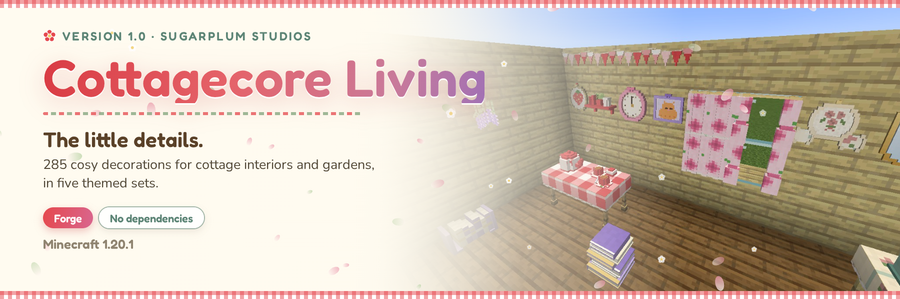

## The little details that make a house feel lived-in.

**Cottagecore Living** adds **285 cosy decorations** to Minecraft, plus five tablecloths and a **Decoration Collection Book** to keep track of them all. Books and candles, vases, clocks, curtains, mirrors and picture frames for the parlour; birdhouses, wind chimes, fountains and fairy doors for the garden; and seasonal decor that **changes with the time of year**. Most of the collection comes in **five themed sets**: Strawberry Cottage, Lavender Home, Pink Garden, Fairycore and Vintage Cottage.

Every decoration is a placeable block with its own 3D model. It faces you when you place it, turns afterwards, and hangs on walls or from ceilings where that makes sense. Many of them do something when you right-click them.

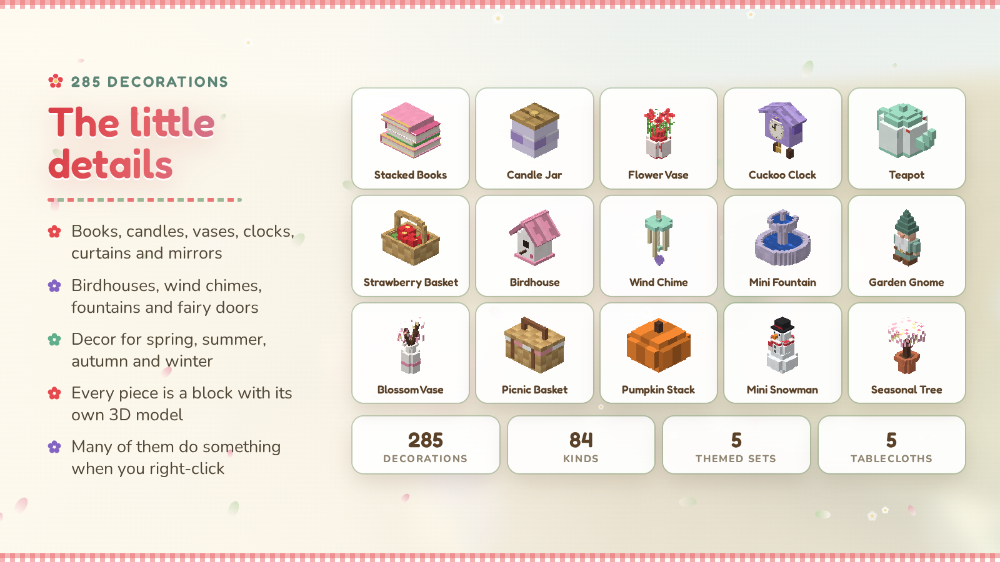

The decorations come in **84 kinds** across three collections, each with its own creative tab:

| Collection | Decorations | What's in it |
| --- | --- | --- |
| **Interior** | 155 | Books, candles, vases, tables, curtains, wall decor, clocks, boxes, mirrors, picture frames, baskets, kitchen and pantry |
| **Garden** | 89 | Birdhouses, wind chimes, garden signs, planters, garden tools, picnic blankets, decorative stones, fountains, lanterns, the fairy garden |
| **Seasonal** | 41 | Cherry blossom, spring flowers, summer picnic, autumn leaves, winter snow, and five pieces that change through the seasons |

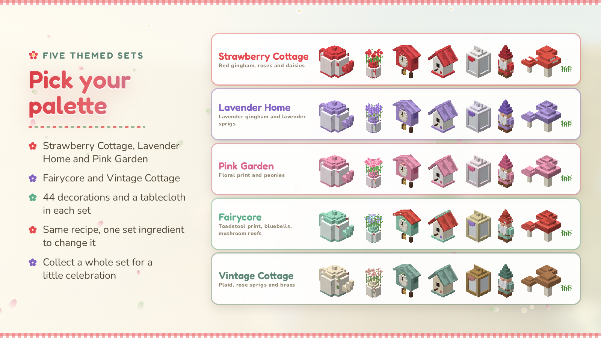

| Set | Palette and motif |
| --- | --- |
| 🍓 **Strawberry Cottage** | Strawberry red and cream, red gingham, roses and daisies |
| 💜 **Lavender Home** | Lavender and butter, lavender gingham, lavender sprigs |
| 🌸 **Pink Garden** | Rose pink, floral print, peonies |
| 🍄 **Fairycore** | Mint and lilac, toadstool print, bluebells, mushroom roofs |
| 🫖 **Vintage Cottage** | Sage teal, faded rose and brass, plaid and rose sprigs |

- Each set has **44 decorations** and its own tablecloth.
- Every set version of a decoration uses the same recipe, with one **set ingredient** that picks the set (see **Crafting**).
- Collect a whole set for a little celebration.

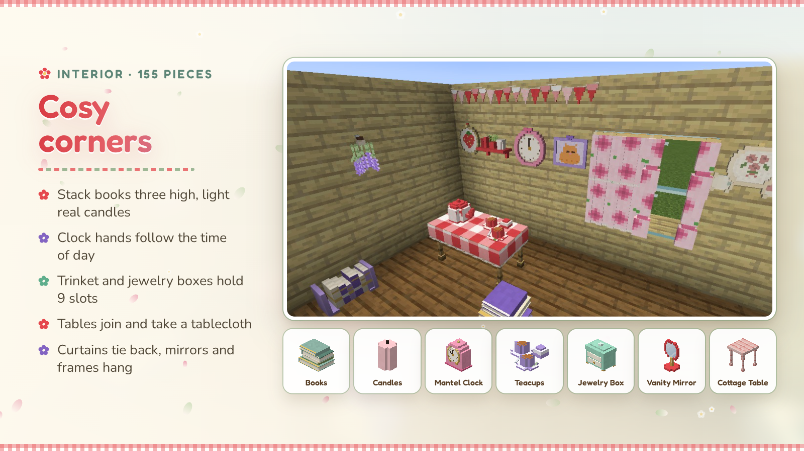

Items marked **×5** come in all five sets.

| Group | Decorations | What they do |
| --- | --- | --- |
| **Books** | Stacked Books ×5, Open Book ×5, Book Row ×5 | Stack books three high. Right-click an open book to read a line |
| **Candles** | Pillar Candles ×5, Candle Jar ×5, Candlestick ×5, Candle Sconce ×5 | Light 4 per pillar candle (up to 12), jars 6, candlesticks 7, sconces 8, with real flame particles |
| **Vases** | Flower Vase ×5, Bud Vase ×5 | Each set has its own bouquet: roses and daisies, lavender, peonies, bluebells, dusty roses |
| **Tables** | Cottage Table in oak, spruce, birch, dark oak and cherry | Full height, so decorations stand right on top. Tables side by side join. Dress them with a **tablecloth**; shears take it off |
| **Curtains** | Curtains ×5 | Hang against a window and right-click to tie them back. Stack them for tall windows: only the top shows the rod, and the whole column opens together |
| **Wall decor** | Embroidery Hoop ×5, Wall Plates ×5, Dried Flower Bundle ×5, Bunting ×5, Little Wall Shelf ×5 | |
| **Clocks** | Wall Clock ×5, Mantel Clock ×5, Cuckoo Clock ×5 | The hour hand follows the time of day. Right-click to read the time. Cuckoo clocks call out every hour |
| **Boxes** | Trinket Box ×5, Jewelry Box ×5 | 9 slots each, and the lid opens while in use. The jewelry box chimes. Hoppers and comparators work |
| **Mirrors** | Oval Wall Mirror ×5, Vanity Mirror ×5 | Right-click for a compliment |
| **Picture frames** | Picture Frame ×5 (wall), Standing Photo Frame ×5 | Eight little paintings each; right-click to swap |
| **Baskets** | Wicker Basket, and baskets of apples, bread, yarn, eggs, wildflowers, mushrooms, linens, strawberries and lavender | Craft an empty basket, then fill it |
| **Kitchen & pantry** | Teapot ×5, Teacups ×5, Potted Basil, Rosemary, Mint, Thyme and Sage, Jars of Wildflowers, Buttons, Honey and Ribbons, Firefly Jar | Teapots and teacups steam; the firefly jar glows (light 9) |

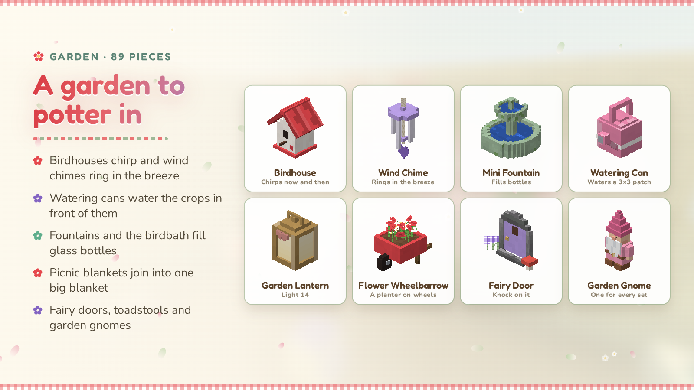

| Group | Decorations | What they do |
| --- | --- | --- |
| **Birdhouses** | Birdhouse ×5 | On a post or hung from a branch. Birds chirp now and then |
| **Wind chimes** | Wind Chime ×5 | Hang from a ceiling or a wall bracket. They ring in the breeze, more often in the rain |
| **Garden signs** | Garden Sign ×5 | Eight painted pictures: welcome heart, herbs, strawberries, tulips, bees, carrots, toadstools and sunshine |
| **Planters** | Flower Basket ×5, Hanging Planter ×5, Window Box ×5, Flower Wheelbarrow ×5 | |
| **Garden tools** | Watering Can ×5, Garden Tool Rack, Bucket of Garden Tools, Garden Gloves ×5, Seed Packet Crate | The watering can waters the 3×3 patch in front of it and gives crops a little growth |
| **Picnic blankets** | Picnic Blanket ×5 | Blankets side by side join into one, with a single fringed border |
| **Decorative stones** | Stepping Stones (stone, mossy, sandstone, slate), Painted Rock ×5, Stone Cairn | |
| **Fountains** | Mini Fountain ×5, Birdbath | Animated water tinted to the biome. They fill glass bottles |
| **Lanterns** | Garden Lantern ×5 | Light 14. Stand them or hang them; right-click to light |
| **Fairy garden** | Fairy Door ×5, Toadstools ×5, Garden Gnome ×5 | Knock on a fairy door: it opens for a moment, and sometimes there's a little gift |

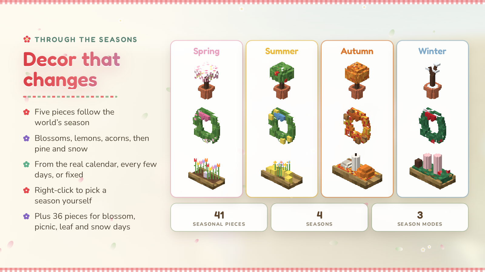

| Theme | Decorations |
| --- | --- |
| **Cherry blossom** | Garland, Branch Vase, Paper Lantern, Wreath, Scattered Petals (the petals drift down) |
| **Spring flowers** | Crate of Tulips, Potted Daffodils, Flower Crown ×5, Basket of Painted Eggs, Bunny Figurine |
| **Summer picnic** | Picnic Basket (9 slots), Lemonade Pitcher, Summer Fruit Platter, Sun Hat ×5, Jam Jars |
| **Autumn leaves** | Leaf Piles in red, orange and golden (walk right through them), Pumpkin Stack, Autumn Wreath, Bowl of Acorns, Apple Crate |
| **Winter snow** | Winter Wreath, Mini Snowman, Pine Garland (twinkles, light 6), Hot Cocoa, Snow Globe (shake it), Winter Lantern |
| **Through the seasons** | Seasonal Wreath, Seasonal Garland, Seasonal Centerpiece, Little Seasonal Tree, Seasonal Doormat |

The five **through the seasons** decorations change with the world's season: blossoms in spring, lemons and sunflower yellows in summer, acorns and orange leaves in autumn, and pine, holly and snow in winter. Right-click one to pick a season yourself; keep clicking past winter to let it follow the world again.

The server decides what season it is: from its **real-world calendar** (the default), turning **every few in-game days**, or **fixed** to one season. The Collection Book shows the current season.

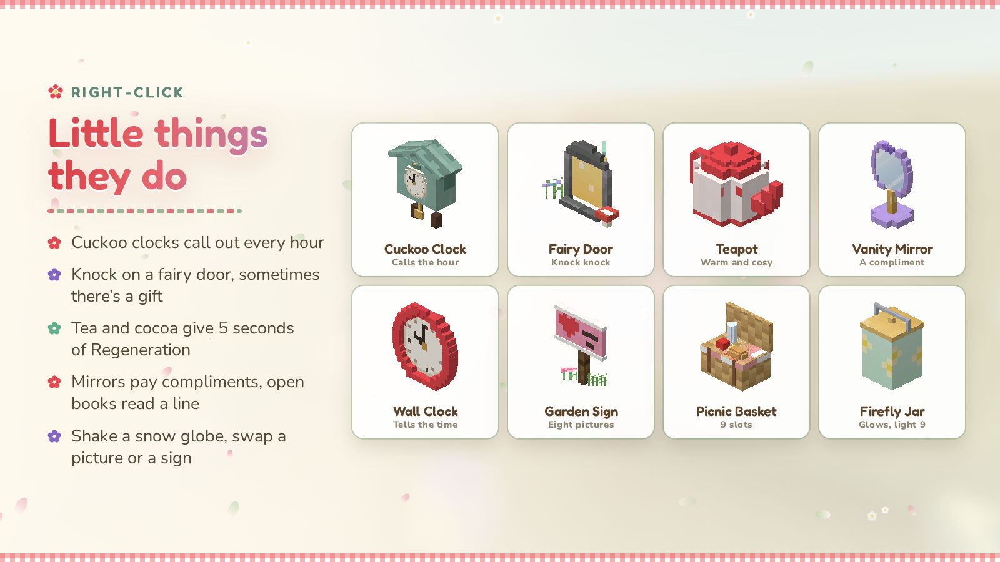

Right-click with an empty hand and a decoration does its own little thing. Every tooltip says what.

| Decoration | Right-click |
| --- | --- |
| **Clocks** | Tells you the time. Cuckoo clocks also call out every in-game hour |
| **Fairy Door** | Knock: it opens for a moment, and sometimes a fairy leaves a small gift |
| **Teapot, Teacups, Hot Cocoa** | A warm, cosy moment: steam and 5 seconds of Regeneration (once every 30 seconds) |
| **Mirrors** | A compliment |
| **Open Book** | Reads you a line |
| **Picture frames and Garden Signs** | Swap the picture |
| **Snow Globe** | Shake it |
| **Birdhouse** | Hear who lives there |
| **Wind Chime** | Ring it |
| **Trinket Box, Jewelry Box, Picnic Basket** | Open its 9 slots |
| **Lanterns** | Switch them on or off |
| **Watering Can** | Water the crops in front of it |
| **Mini Fountain, Birdbath** | Fill a glass bottle (right-click with one) |
| **Curtains** | Tie them back or let them down |
| **Seasonal decorations** | Pick a season |

Candles are lit with **flint and steel** or a **fire charge**; an empty hand snuffs them.

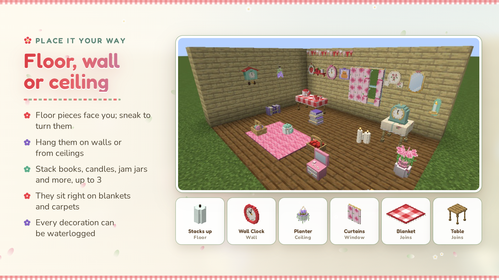

| Do this | What happens |
| --- | --- |
| **Place** | Floor decorations face you. Click the side of a block to hang wall decorations; click the underside of a block to hang lanterns, chimes, planters and birdhouses |
| **Sneak** and use with an empty hand | Turns a floor or hanging decoration a quarter turn |
| Place **the same item** on it | Adds to a stack: books, pillar candles, jam jars, pumpkins, hot cocoa mugs, stone cairns and leaf piles, up to 3 |
| Use a **tablecloth** on a Cottage Table | Dresses the table; shears take it off again |

- Decorations need something to stand on, hang from or hang against. If that block is broken, the decoration drops.
- Floor decorations placed on something thin, like a picnic blanket or a carpet, settle onto it instead of floating a block up, so a picnic basket really sits on its blanket.
- Decorations can be waterlogged.

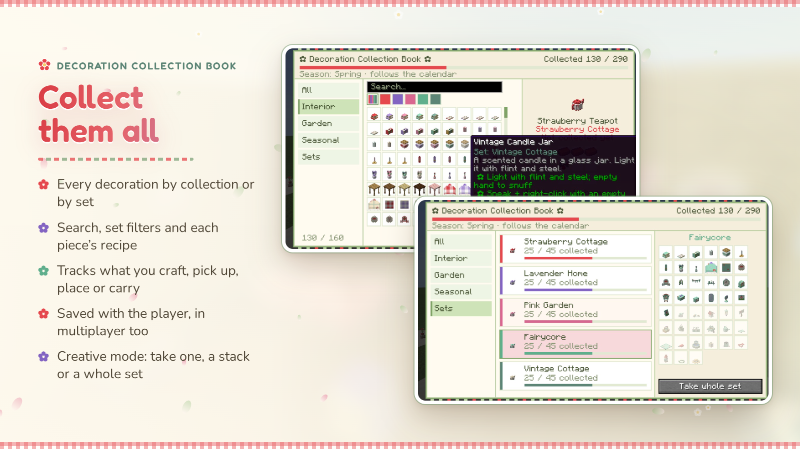

The **Decoration Collection Book** is crafted from a book and any small flower, and every player gets one the first time they join.

- **Browse** every decoration by collection (Interior, Garden, Seasonal) or by set, with search and set filters.
- **Each entry** shows the decoration, its set, what it does and its crafting recipe.
- **It tracks your collection:** anything you craft, pick up, place or carry is collected. Entries you haven't collected yet are faded, and the header shows your progress and the current season.
- Collections are **saved on the server** with the player, so they work in multiplayer and survive death.
- In **creative mode**, the book hands decorations out: one, a stack or a whole set.

Every decoration has a crafting recipe, and all of them are unlocked in your recipe book when you join. The Collection Book shows each one.

The set versions of a decoration share one recipe with a **set ingredient** that picks the set:

| Set | Set ingredient (any one) |
| --- | --- |
| Strawberry Cottage | Red dye or sweet berries |
| Lavender Home | Purple dye or lilac |
| Pink Garden | Pink dye, pink petals or a peony |
| Fairycore | Lime dye or glow berries |
| Vintage Cottage | Brown dye or cyan dye |

A few examples:

| Item | Recipe |
| --- | --- |
| Decoration Collection Book | A book and any small flower |
| Teapot ×5 | Three bricks and a set ingredient |
| Tablecloth ×5 | Two white carpets and a set ingredient |
| Cottage Table ×2 | Three wooden slabs over four fences of the same wood |
| Wicker Basket | Five wheat in a basket shape |
| Basket of Apples | A Wicker Basket and two apples |
| Little Seasonal Tree | A flower pot and any sapling |

The set ingredients are item tags (`cottagecoreliving:sets/<set>`), so a data pack can add more.

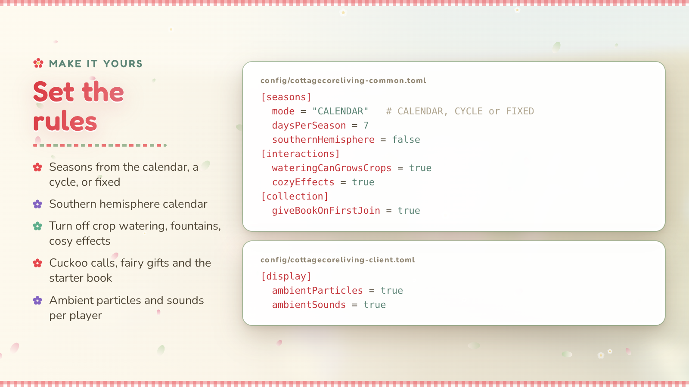

`config/cottagecoreliving-common.toml` holds the server rules:

| Setting | Default | |
| --- | --- | --- |
| `seasons.mode` | `CALENDAR` | `CALENDAR` (the server's real date), `CYCLE` (every few in-game days) or `FIXED` |
| `seasons.fixedSeason` | `SPRING` | Used when the mode is `FIXED` |
| `seasons.daysPerSeason` | `7` | Used when the mode is `CYCLE` |
| `seasons.southernHemisphere` | `false` | Flips the calendar |
| `interactions.wateringCanGrowsCrops` | `true` | |
| `interactions.fountainsFillBottles` | `true` | |
| `interactions.cozyEffects` | `true` | Tea and cocoa give 5 seconds of Regeneration (once per 30 seconds) |
| `interactions.cuckooCalls` | `true` | |
| `interactions.fairyGifts` | `true` | |
| `collection.giveBookOnFirstJoin` | `true` | |
| `collection.collectionMessages` | `true` | |
| `collection.deliveryInSurvival` | `false` | Lets the book hand out decorations in survival (a cheat) |
| `collection.unlockAllRecipes` | `true` | Unlocks every recipe in the recipe book on join |

`config/cottagecoreliving-client.toml` turns the ambient particles, ambient sounds and detailed tooltips on or off for each player.

- **Three creative tabs:** *Cottagecore Living: Interior*, *Garden* and *Seasonal*.
- **Light on performance:** every decoration is a static baked model, with no block entity renderers. Clocks wake once per in-game hour, seasonal pieces tick only while they follow the world's season, and nothing else ticks. Ambient particles and sounds are client-side only and can be turned off.
- **Multiplayer-ready:** all state lives on the server, and creative delivery from the book is checked by the server and only hands out the mod's own items.
- **Item tags** for data packs: `cottagecoreliving:decorations`, `cottagecoreliving:tablecloths` and the five `cottagecoreliving:sets/<set>` ingredient tags.

| Minecraft | Loader | Java | Also install |
| --- | --- | --- | --- |
| 1.20.1 | Forge 47 or newer | 17+ | Nothing |

- Install Cottagecore Living on **both the server and every client**.
- Cottagecore Living is a mod. It does not work as a Paper, Spigot or Folia plugin.

**Does it need any other mods?**
No. Cottagecore Living needs only Forge.

**Does it change vanilla blocks?**
No. Every decoration is a new block of its own; vanilla blocks are left alone.

**Do the seasons follow a seasons mod?**
No. The seasonal decorations follow the mod's own season, taken from the server's calendar by default. Set `seasons.mode` to `CYCLE` to turn the seasons every few in-game days, or to `FIXED` to keep one season. You can also pick a season for any seasonal decoration by right-clicking it.

**I live in the southern hemisphere. Is it Christmas in summer?**
Set `seasons.southernHemisphere` to `true` and the calendar flips.

**Can I get every decoration without crafting it?**
In creative mode, the Collection Book hands out one, a stack or a whole set. In survival it only shows recipes, unless the server turns on `collection.deliveryInSurvival`.

**Does my collection carry over between worlds?**
It's saved with your player on each world or server, and it survives death.

**Is there a Fabric or NeoForge version?**
Not yet. Cottagecore Living runs on Forge for Minecraft 1.20.1.

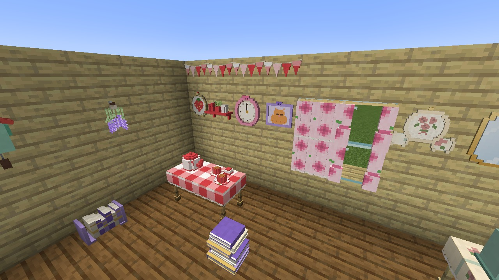

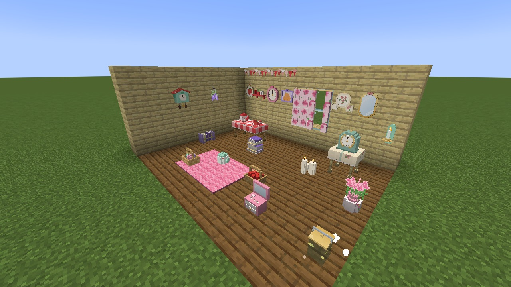

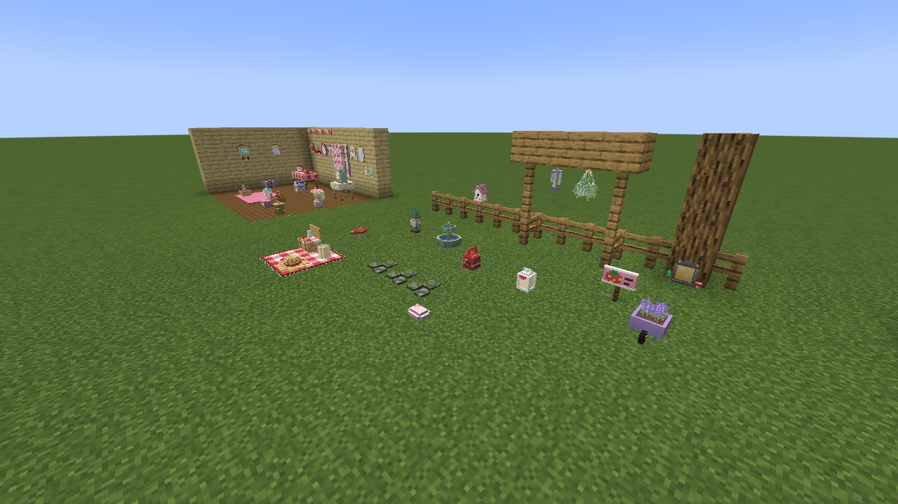

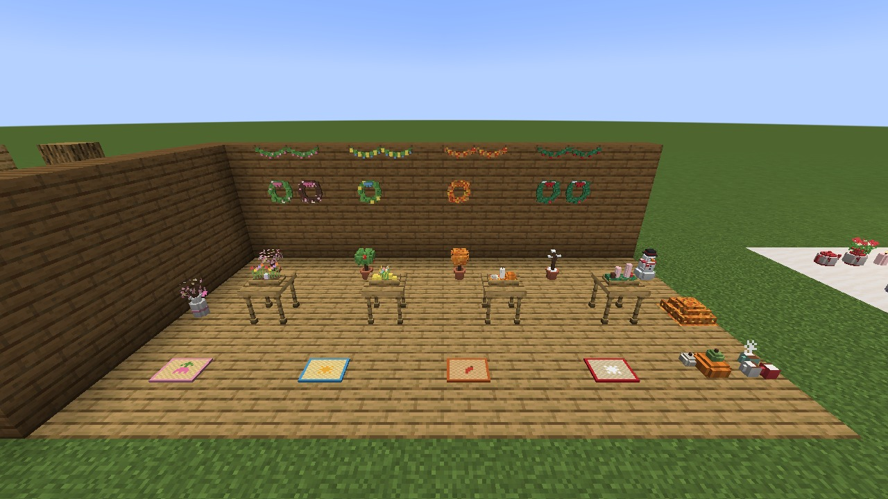

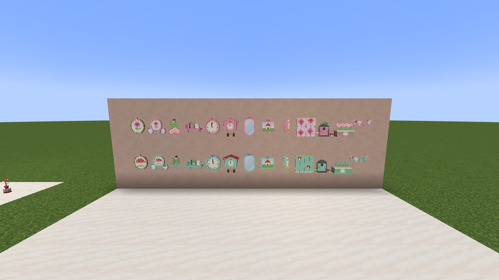

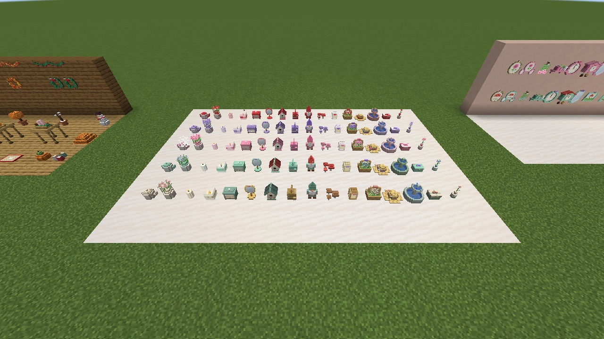

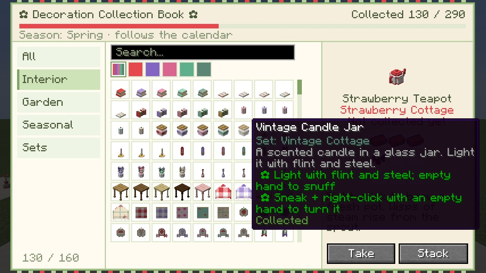

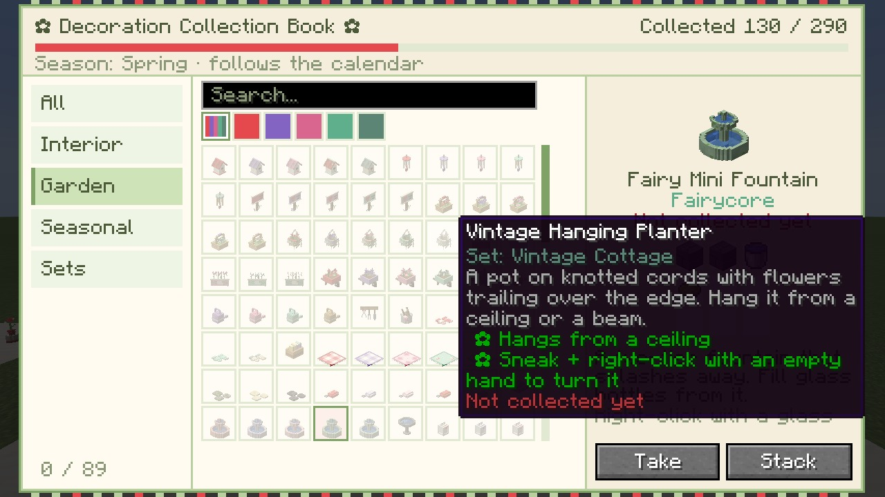

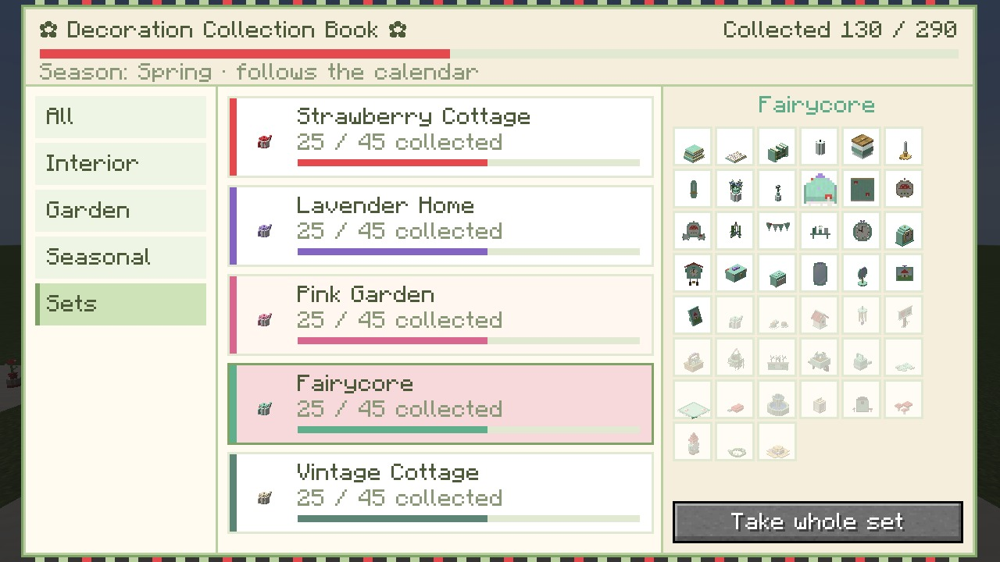

---

Cottagecore Living is made by Sugarplum Studios and released under the Apache License 2.0. The Fredoka and Nunito fonts used in this artwork are licensed under the SIL Open Font License 1.1.
